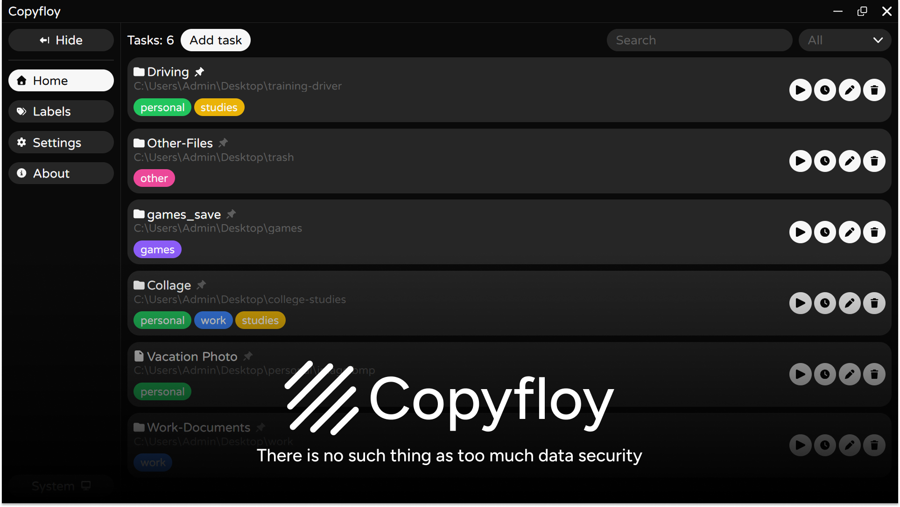

<h1 align="center">📁 Copyfloy</h1>

<div align="center">

[](https://www.electronjs.org/)
[](https://electron-vite.org/)
[](https://react.dev/)
[](https://www.typescriptlang.org/)
[](https://nodejs.org/)
[](https://eslint.org/)
[](https://stylelint.io/)
[](https://www.microsoft.com/windows)
[](./LICENSE)

</div>



> [!WARNING]
> **Experimental - not ready for public use.** The application is under active development and may contain bugs or incomplete features. It may change without notice and is not recommended for production use.

---

<br />

## ✨ About

Windows desktop application that automates recurring copying of local files and folders.

Instead of copying the same folders by hand, you create a task once - a source, a destination and, optionally, a schedule - and application runs it for you. Tasks can be started manually or on a schedule, and the app can keep working in the system tray with its window closed. Typical uses are periodic backups to another drive or a USB stick.

A task has a single source (a **file or a folder**) and a destination **folder**. The source name is appended to the destination path:

```text
Source        D:\Documents
Destination   E:\Backup
Result        E:\Backup\Documents
```

Copying is one-way: existing files in the destination are overwritten, and nothing is ever deleted there.

---

<br />

## 🚀 Features

**Tasks**

- Create, edit, delete and manually run tasks
- Copy a single file or an entire folder (recursively)
- Pin important tasks to the top of the list
- Search tasks and filter them by type (file / folder)
- Confirmation before deleting a task or closing a form with unsaved changes

**Exclusions**

- Exclude specific files and folders from a copy; multiple paths can be selected at once
- An excluded folder is skipped together with all of its contents

**Scheduling**

- Every N minutes, hourly, daily or on selected days of the week
- Scheduling can be switched off per task
- Optional success notification per task; failures are always reported
- Scheduled tasks run only while the app is running - the tray keeps it alive after the window is closed

**Labels**

- Colored labels with a name, managed on a separate page
- Several labels per task; deleting a label removes it from every task

**Import and export**

- Export all tasks and labels to a JSON file and import them on another machine
- Import either adds to the existing tasks or replaces them
- Imported labels with the same name and color are reused; other tasks and labels get new unique IDs

**Windows integration**

- System tray icon (click to open, right-click for the _Open_ / _Close_ menu)
- Optional minimize-to-tray when the window is closed (enabled by default)
- Optional auto-start with Windows and optional run as administrator. When both are on, the app is launched at logon through a Windows scheduled task, so the elevated start is not blocked. Both options take effect only in the packaged build.
- Single instance: launching the app a second time restores the existing window
- Window state, sidebar state and page zoom (also via keyboard shortcuts) are remembered between launches
- Discord Rich Presence status in the user's Discord profile

**Updates**

- Built-in updater (`electron-updater`) with releases published on GitHub
- Updates are checked, downloaded and installed manually from the Settings page

All data is stored locally as JSON files in Electron's `userData` directory (`tasks.json`, `labels.json`, `settings.json`).

---

<br />

## 🛠 Getting Started

**Requirements:** Windows, [Node.js](https://nodejs.org/) 22.12 or newer and npm.

```bash
git clone https://github.com/eugenevve/copyfloy.git
cd copyfloy
npm install
npm run dev
```

### Scripts

| Command                | Description                                                  |
| ---------------------- | ------------------------------------------------------------ |
| `npm run dev`          | Start the app in development mode (`electron-vite`)          |
| `npm run build`        | Lint CSS and JS/TS, then create the production build         |
| `npm run preview`      | Preview the generated production build                       |
| `npm run build:win`    | Production build + Windows installer (`electron-builder`)    |
| `npm run lint`         | Lint JavaScript/TypeScript with ESLint (no warnings allowed) |
| `npm run lint:fix`     | Lint JavaScript/TypeScript and apply automatic fixes         |
| `npm run lint:css`     | Lint CSS with Stylelint                                      |
| `npm run lint:css:fix` | Lint CSS and apply automatic fixes                           |

---

<br />

## 📦 Building the Windows Installer

```bash
npm run build:win
```

The command runs the linters, builds the app and packages it with `electron-builder`. The installer is written to the `dist` directory:

```text
dist/Copyfloy-setup-<version>.exe
```

The packaging settings live in the `build` section of `package.json`. The installer uses the NSIS target and provides a selectable installation directory (per-user install), a desktop shortcut, application icons, an uninstaller and the MIT license text.

> [!NOTE]
> **Windows security warning.** The executable is not code-signed yet, so Windows Defender SmartScreen may show a warning on launch. This only means the app has no trusted digital signature. Code signing may be added in a future release.

---

<br />

## 🏗 Project Structure

```text
src/
├── main/            # Electron main process
│   ├── services/    # AppService, CopyService, DiscordService, LabelService,
│   │                # NotificationService, SchedulerService, SettingsService,
│   │                # TaskService, TrayService, UpdaterService, WindowService
│   └── utils/
├── preload/         # Secure bridge between main and renderer
├── renderer/        # React UI: Home (tasks), Labels, Settings, About
└── shared/          # Code used by both sides: IPC channel names, types, constants
```

- **Main process** - the core logic: copying, scheduling, storage, tray, updates, system integration. Most services follow one pattern: a service with its logic, an `Ipc` class that exposes it, and a `Storage` class for its JSON file.
- **Preload** - exposes a restricted `window.api` to the UI.
- **Renderer** - the React interface. It has no direct access to Node.js and talks to the main process only through IPC. All channels are listed in `src/shared/constants/ipc.ts`.

For the task lifecycle, scheduling, storage format and the responsibilities of each service, see [Architecture Documentation](./docs/ARCHITECTURE.md).

---

<br />

## 🧰 Tech Stack

| Area            | Technologies                                                             |
| --------------- | ------------------------------------------------------------------------ |
| Desktop runtime | Electron                                                                 |
| UI              | React, React Router (`HashRouter`), CSS Modules                          |
| Language        | TypeScript                                                               |
| File system     | fs-extra                                                                 |
| Scheduling      | node-cron                                                                |
| Updates         | electron-updater (GitHub releases)                                       |
| Integrations    | @xhayper/discord-rpc, Electron Toolkit (`preload`, `utils`)              |
| Build           | electron-vite, electron-builder (NSIS)                                   |
| Code quality    | ESLint (+ TypeScript, React, import plugins), Stylelint, Prettier config |

---

<br />

## 🤝 Contributing

The project is under active development. Bug reports, suggestions and pull requests are welcome - feel free to open an issue or submit a PR.

## 📄 License

Released under the **[MIT License](./LICENSE)**.
