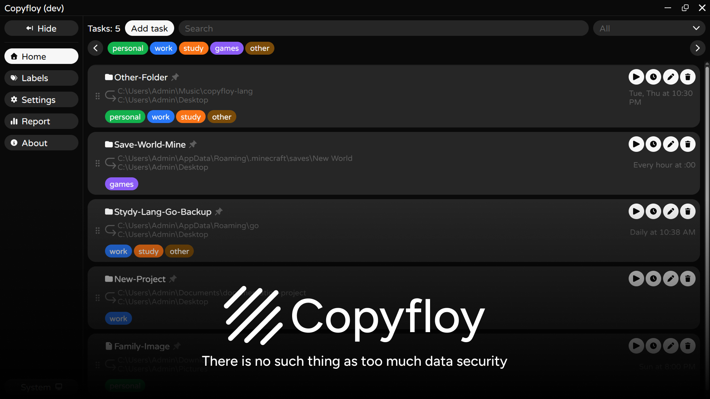
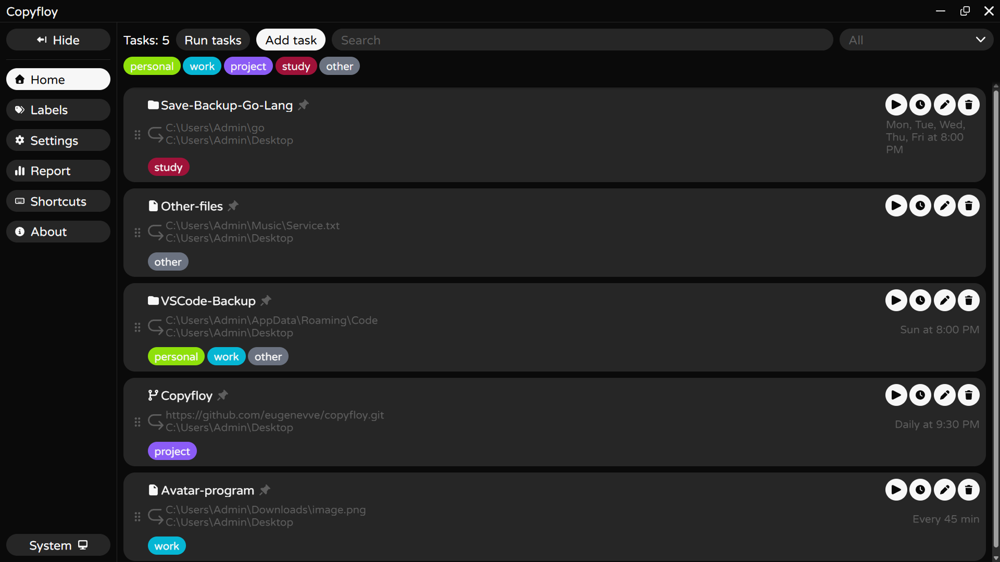
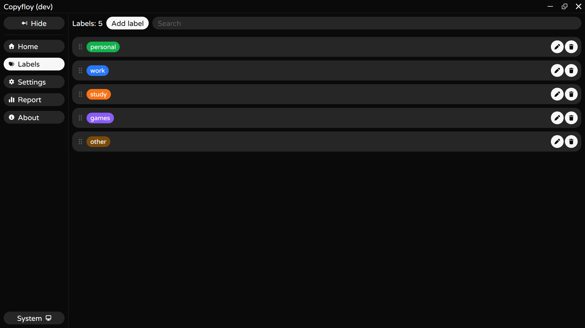
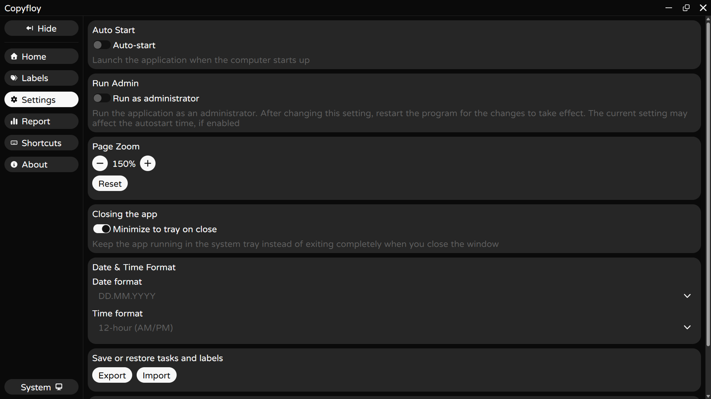
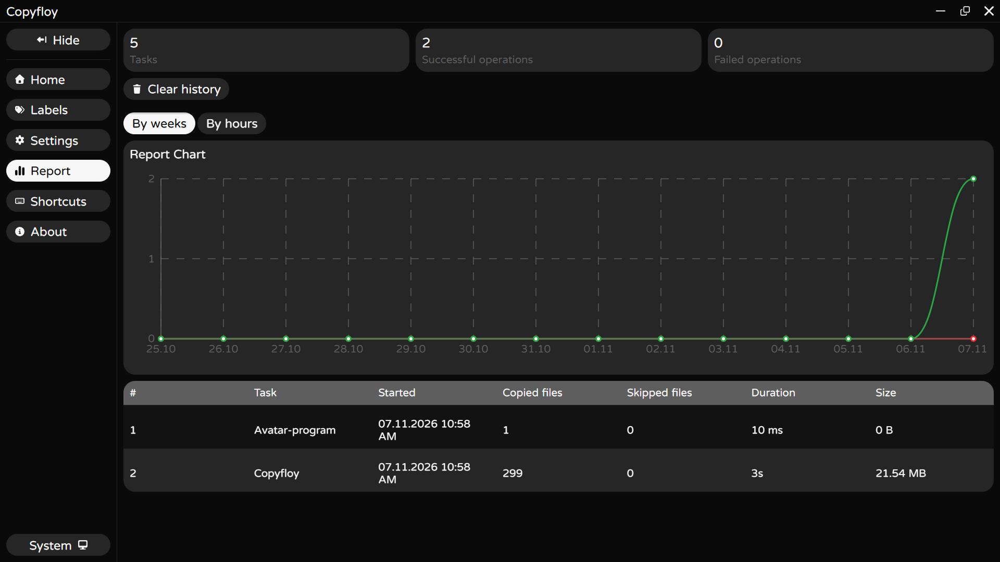
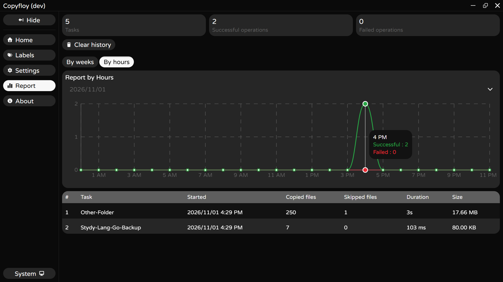
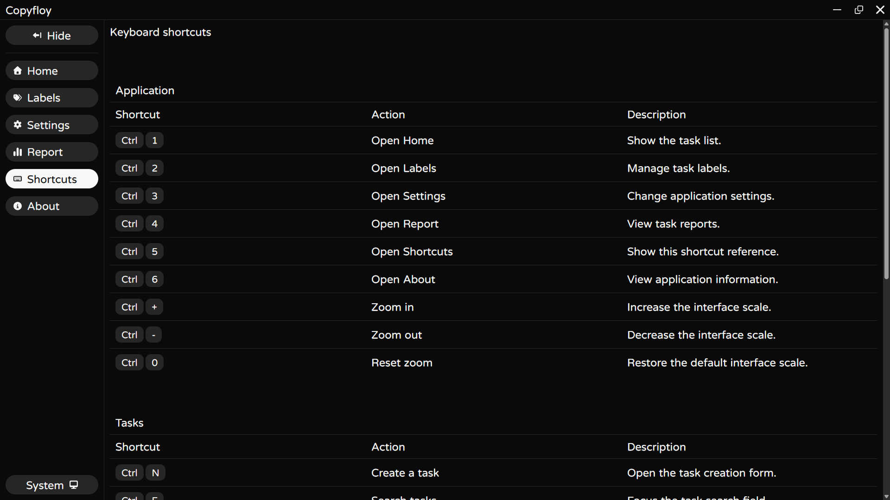

<h1 align="center">📁 Copyfloy</h1>

<div align="center">

[](https://www.electronjs.org/)
[](https://electron-vite.org/)
[](https://react.dev/)
[](https://www.typescriptlang.org/)
[](https://nodejs.org/)
[](https://eslint.org/)
[](https://stylelint.io/)
[](https://www.microsoft.com/windows)
[](./LICENSE)

</div>



> [!WARNING]
> **Experimental - not ready for public use.** The application is under active development and may contain bugs or incomplete features. It may change without notice and is not recommended for production use.

---

<br />

## 🌅 Application interface

<details>
  <summary><b>View screenshots (click to expand)</b></summary>
  
  
  
  
  
  
</details>

<br />

## ✨ About

Windows desktop application that automates recurring copying and backup of local files, folders and Git repositories.

Instead of copying the same folders by hand, you create a task once - a source, a destination and, optionally, a schedule - and application runs it for you. Tasks can be started manually or on a schedule, and the app can keep working in the system tray with its window closed. Typical uses are periodic backups to another drive or a USB stick.

A task has a single source (a **file, a folder or a Git repository**) and a destination **folder**. For files and folders the source name is appended to the destination path:

```text
Source        D:\Documents
Destination   E:\Backup
Result        E:\Backup\Documents
```

Copying is one-way: existing files in the destination are overwritten, and nothing is ever deleted there. Instead of a copy, a task can also produce a single **ZIP archive**.

---

<br />

## 📥 Download

Ready-made builds are published on the [Releases](https://github.com/eugenevve/copyfloy/releases) page. Windows on x64 (Intel / AMD) and on ARM64 are supported.

| Build         | File                                                 | Description                                                                                                                                                               |
| ------------- | ---------------------------------------------------- | ------------------------------------------------------------------------------------------------------------------------------------------------------------------------- |
| **Installer** | `Copyfloy-setup-<version>.exe`                       | Recommended. One file for both x64 and ARM64: the matching version is installed automatically. The installation folder can be chosen; updates are installed from the app. |
| **Portable**  | `Copyfloy-portable-<version>-x64.zip` / `-arm64.zip` | No installation: unpack the archive and run the executable. Updated manually.                                                                                             |

> [!NOTE]
> **Windows security warning.** The executable is not code-signed yet, so Windows Defender SmartScreen may show a warning on launch. This only means the app has no trusted digital signature. Code signing may be added in a future release.

---

<br />

## 🚀 Features

**Tasks**

- Create, edit, delete and manually run tasks
- Copy a single file, an entire folder (recursively) or a Git repository
- Optional **ZIP archive** instead of a copy: `<destination>\<name>.zip`
- Live progress for running tasks and a **Stop** button to cancel them
- **Run tasks** button: run all tasks, or only those that match the current filters, one after another
- Pin important tasks to the top of the list
- Reorder tasks by drag and drop, with the mouse or the keyboard
- Search tasks and filter them by type (file / folder / repository) and by labels
- Up to 1000 tasks and 1000 labels; lists show the first 100 items, the rest is loaded with the **Show more** button
- Confirmation before deleting a task or closing a form with unsaved changes

**Exclusions and archives**

- Exclude specific files and folders from a copy or an archive (folder tasks); an excluded folder is skipped together with all of its contents
- Files and folders are packed into `<destination>\<source name>.zip`, repositories (including `.git`) into `<destination>\<repository name>.zip`; an existing archive with the same name is replaced
- A stopped or failed run leaves no incomplete archive behind

**Git repositories**

- Back up repositories from **GitHub** and **GitLab** (HTTPS URLs on `github.com` / `gitlab.com` only)
- First run clones the repository into `<destination>\<repository name>`; later runs update it with `git pull --ff-only`. If the destination already contains a different repository, the task fails instead of overwriting it
- Private repositories are supported with a personal access token. The token is encrypted with Electron `safeStorage` (OS-level encryption) before it is written to `tasks.json`
- Requires [Git](https://git-scm.com/) to be installed and available in `PATH`; otherwise repository tasks are disabled in the UI

**Stopping tasks**

- A running task can be cancelled at any time; files that were already copied are kept
- A partially written file is removed; a partial clone is removed only if it was created by that run, an existing folder is never deleted
- Cancelled runs are not recorded in the report

**Scheduling**

- Every N minutes (1-60), hourly, daily or on selected days of the week
- The schedule is configured in a separate dialog (the clock button on the task card) and can be switched off per task
- Optional system notification after a successful run, enabled by default; failures are always reported
- Scheduled tasks run only while the app is running - the tray keeps it alive after the window is closed

**Missed runs**

- If the app was not running at the scheduled time, it notices that on the next launch
- For every task with an hourly, daily or weekly schedule that did not run since its last scheduled time, a **Task skipped** prompt offers to **Run now** or **Skip**; prompts are shown one by one
- The answer is remembered, so the same missed run is not offered again
- Tasks that run every N minutes are not checked

**Reports**

- A separate **Report** page with the number of tasks, successful and failed operations
- Charts of successful and failed runs: **By weeks** (14 days ending with the latest day that has records) and **By hours** (24 hours of a selected day)
- History table: task, start time, copied files, skipped files, duration, total size; failed runs are highlighted and show the error on hover
- Records are stored in `report.json` (the last 1000 are kept) and can be cleared with one click

**Labels**

- Colored labels with a name, managed on a separate page with search
- Reorder labels by drag and drop
- Several labels per task; deleting a label removes it from every task

**Keyboard shortcuts**

- Switch pages with `Ctrl` + `1`-`6`; create, search, edit, schedule and delete tasks and labels without the mouse
- Select a task or a label with `↑` / `↓`, run or stop the selected task with `Enter`, clear the selection with `Esc`
- Shortcuts are ignored while a dialog is open; page shortcuts are also ignored in text fields
- The full list is on the **Shortcuts** page (`Ctrl` + `5`)

**Import and export**

- Export all tasks and labels to a JSON file and import them on another machine
- Access tokens of private repositories are **never exported**: after import, edit such a task and enter the token again
- Import either adds to the existing tasks or replaces them
- Imported labels with the same name and color are reused; other tasks and labels get new unique IDs

**Appearance**

- Light, dark or system theme, switched with one button in the sidebar
- Date format (`DD/MM/YYYY`, `MM/DD/YYYY`, `YYYY-MM-DD` and other variants with `/`, `.` or `-`) and 12 / 24-hour time format; the choice is applied to the task list, the report and the charts
- Page zoom (50-300 %) with a reset button and the shortcuts `Ctrl` + `+` / `-` / `0`

**Windows integration**

- System tray icon (click to open, right-click for the _Open_ / _Close_ menu)
- Optional minimize-to-tray when the window is closed (enabled by default)
- Optional auto-start with Windows and optional run as administrator (packaged build only). When both are on, the app is launched at logon through a Windows scheduled task, so the elevated start is not blocked
- Single instance: launching the app a second time restores the existing window
- Window state, sidebar state and page zoom are remembered between launches
- Discord Rich Presence status in the user's Discord profile

**Updates**

- Built-in updater (`electron-updater`) with releases published on GitHub
- **Installed version:** updates are checked, downloaded and installed from the Settings page; the app restarts itself after the installation
- **Portable version:** the check works, but nothing is downloaded or installed. When a new version is found, the app shows a message with a link to the Releases page - download the new ZIP archive and replace the application files

All data is stored locally as JSON files in Electron's `userData` directory (`tasks.json`, `labels.json`, `settings.json`, `report.json`, `missed-dismissed.json`). The selected theme is stored in the local storage of the application window.

---

<br />

## 🛠 Getting Started

**Requirements:** Windows, [Node.js](https://nodejs.org/) 24 or newer and npm. [Git](https://git-scm.com/) is optional and needed only for repository tasks.

```bash
git clone https://github.com/eugenevve/copyfloy.git
cd copyfloy
npm install
npm run dev
```

### Scripts

| Command                 | Description                                                                                                    |
| ----------------------- | -------------------------------------------------------------------------------------------------------------- |
| `npm run dev`           | Start the app in development mode (`electron-vite`)                                                            |
| `npm run build`         | Lint CSS and JS/TS, then create the production build                                                           |
| `npm run preview`       | Preview the generated production build                                                                         |
| `npm run build:win`     | Production build + Windows installer for x64 (`electron-builder`)                                              |
| `npm run build:win:all` | Production build + all Windows packages: installer (x64 and ARM64) and portable ZIP archives for x64 and ARM64 |
| `npm run lint`          | Lint JavaScript/TypeScript with ESLint (no warnings allowed)                                                   |
| `npm run lint:fix`      | Lint JavaScript/TypeScript and apply automatic fixes                                                           |
| `npm run lint:css`      | Lint CSS with Stylelint                                                                                        |
| `npm run lint:css:fix`  | Lint CSS and apply automatic fixes                                                                             |
| `npm run icons`         | Generate `resources/icon.ico` and `resources/icon.png` from `resources/icon.svg`                               |
| `npm run icons-check`   | Print the sizes stored in `resources/icon.ico`                                                                 |

In development mode the app stores its data in a separate `<name>-dev` folder, so it never touches the data of the installed version.

Build results are written to the `dist` directory. Packaging settings live in the `build` section of `package.json`.

### Releasing

A release is created manually by the **Release** workflow (`.github/workflows/release.yml`) and only on `main`:

1. Raise the `version` in `package.json` and commit it with the version number as the commit message (`X.Y.Z`).
2. Run the **Release** workflow on `main`.

The workflow builds all Windows packages and publishes them as a GitHub release. The release notes are the commit subjects since the previous version commit. Details are in the [Architecture Documentation](./docs/ARCHITECTURE.md).

---

<br />

## 🏗 Project Structure

```text
src/
├── main/            # Electron main process: services, storage, scheduling, tray, updates
├── preload/         # Secure bridge between main and renderer
├── renderer/        # React UI: Home (tasks), Labels, Report, Settings, Shortcuts, About
└── shared/          # Code used by both sides: IPC channel names, types, constants
```

- **Main process** - the core logic. Most services follow one pattern: a service with its logic, an `Ipc` class that exposes it, and a `Storage` class for its JSON file.
- **Preload** - exposes a restricted `window.api` to the UI.
- **Renderer** - the React interface. It has no direct access to Node.js and talks to the main process only through IPC. All channels are listed in `src/shared/constants/ipc.ts`.

For the task lifecycle, scheduling, storage format and the responsibilities of each service, see [Architecture Documentation](./docs/ARCHITECTURE.md).

---

<br />

## 🧰 Tech Stack

| Area            | Technologies                                                             |
| --------------- | ------------------------------------------------------------------------ |
| Desktop runtime | Electron                                                                 |
| UI              | React, React Router (`HashRouter`), CSS Modules                          |
| Charts          | Recharts                                                                 |
| Drag and drop   | dnd-kit                                                                  |
| Language        | TypeScript                                                               |
| File system     | fs-extra                                                                 |
| Archives        | archiver (ZIP)                                                           |
| Git             | System `git`, started as a child process                                 |
| Scheduling      | node-cron                                                                |
| Updates         | electron-updater (GitHub releases)                                       |
| Integrations    | @xhayper/discord-rpc, Electron Toolkit (`preload`, `utils`)              |
| Build           | electron-vite, electron-builder (NSIS installer, ZIP), x64 and ARM64     |
| Releases        | GitHub Actions                                                           |
| Code quality    | ESLint (+ TypeScript, React, import plugins), Stylelint, Prettier config |

---

<br />

## 🤝 Contributing

The project is under active development. Bug reports, suggestions and pull requests are welcome - feel free to open an issue or submit a PR.

## 📄 License

Released under the **[MIT License](./LICENSE)**.
